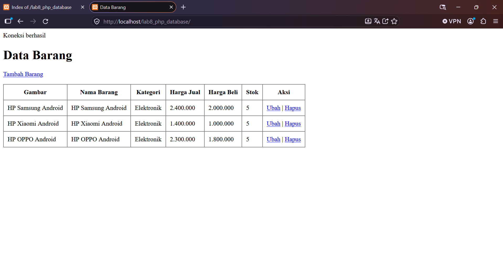
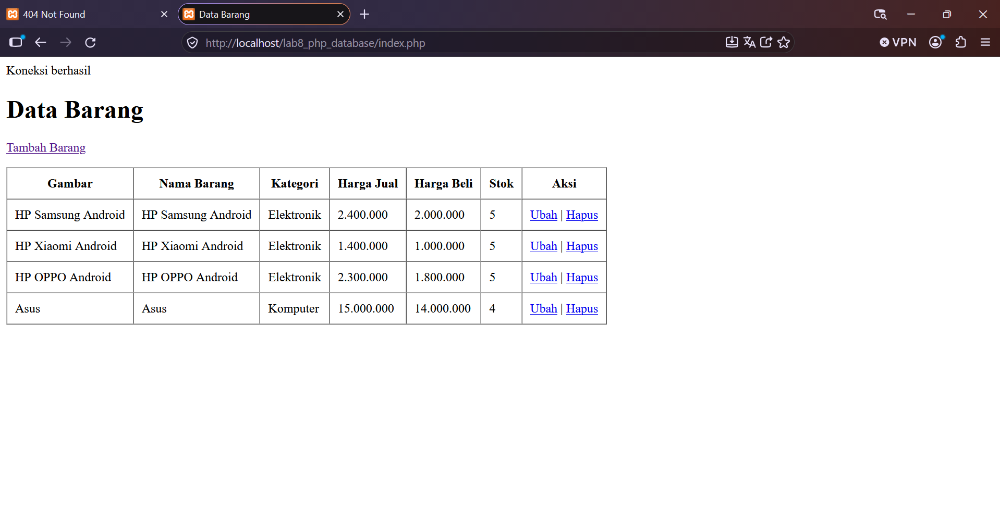
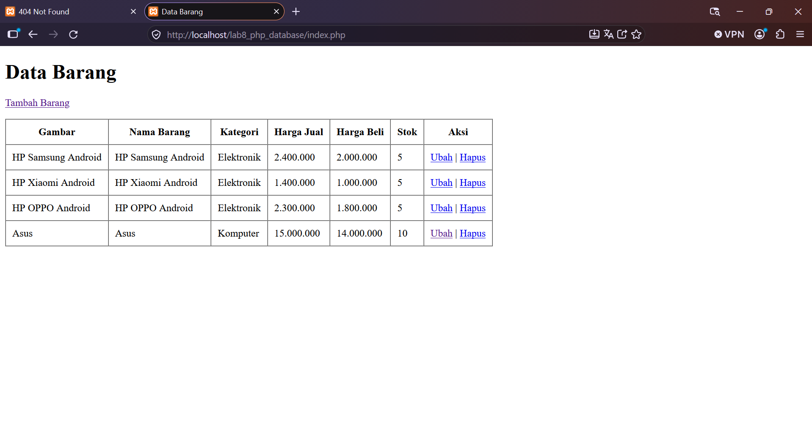
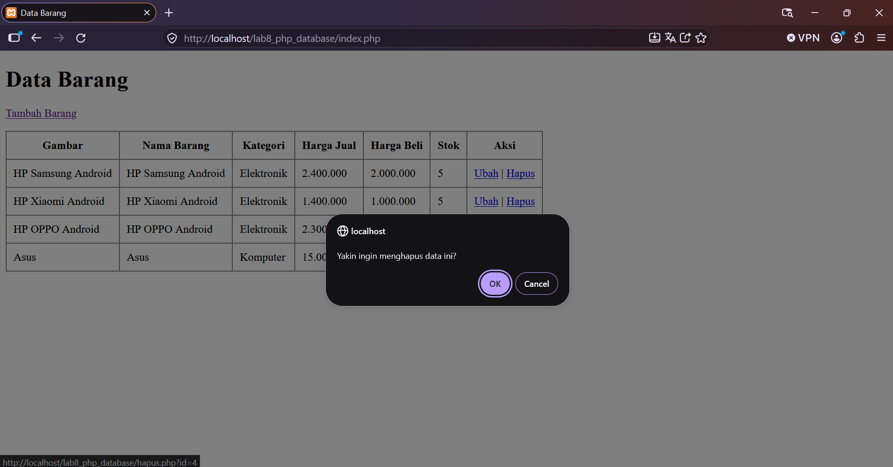

# Praktikum PHP dan MySQL
## Aplikasi Manajemen Data Barang

### Identitas Mahasiswa
- Nama: Mardian Illham Aryana
- NIM: 312510469

### Deskripsi
Project ini merupakan aplikasi sederhana untuk mengelola data barang menggunakan PHP dan database MySQL. Aplikasi dibuat sebagai bagian dari Praktikum Pemrograman Web.

### Teknologi yang Digunakan
- PHP
- MySQL
- HTML
- CSS
- XAMPP
- phpMyAdmin

### Fitur Aplikasi
1. **Read:** Menampilkan data barang dari database.
2. **Create:** Menambahkan data barang baru.
3. **Update:** Mengubah informasi barang.
4. **Delete:** Menghapus data barang.

### Struktur Folder
```text
lab8_php_database/
│
├── gambar/
├── koneksi.php
├── index.php
├── tambah.php
├── ubah.php
├── hapus.php
├── style.css
└── README.md
```

### Database
Nama database: `latihan1`

Nama tabel: `data_barang`

Kolom tabel:
- id_barang
- kategori
- nama
- gambar
- harga_beli
- harga_jual
- stok

### Dokumentasi Screenshot

#### 1. Halaman Data Barang


#### 2. Halaman Tambah Barang


#### 3. Halaman Ubah Barang


#### 4. Halaman Hapus Barang


### Kesimpulan
Melalui praktikum ini, saya mempelajari cara menghubungkan PHP dengan database MySQL serta membuat aplikasi CRUD sederhana untuk mengelola data barang.